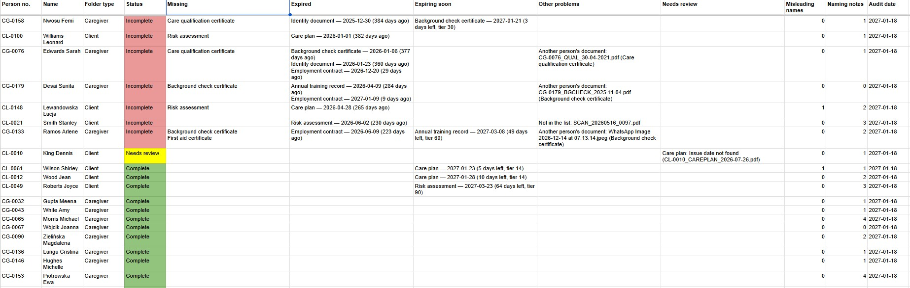
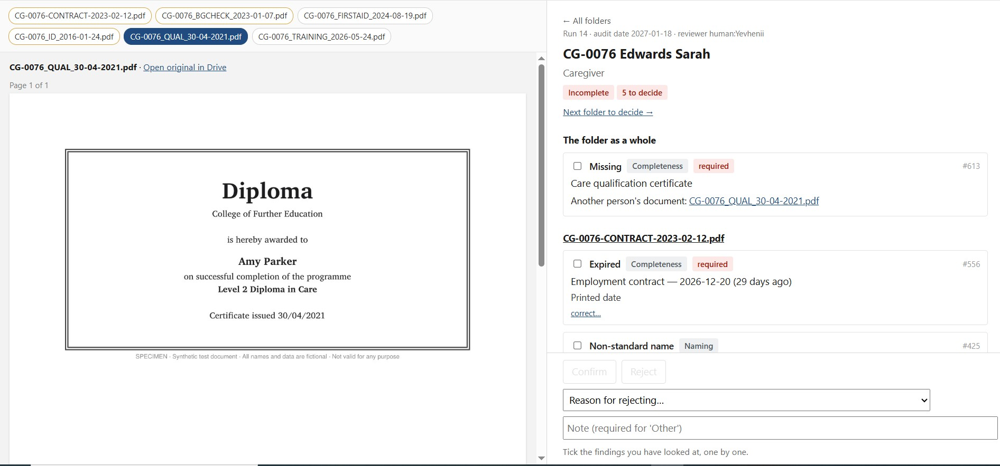

# Osprey Document Bench

**Finds what is missing, expired or misfiled in folders of documents — and measures how much of it it actually finds.**

If your organisation keeps a folder per employee, contractor or client — IDs, contracts, certificates, training records, care plans — someone has to check that every folder is complete and in date. Osprey reads every document in your Google Drive folders, recognises each one by its content, and tells you, person by person, what is missing, expired, expiring soon, belongs to someone else or is filed under the wrong name.

## Measured, not claimed

Osprey was tested on two batches of synthetic folders with problems planted on purpose and recorded before the system ever saw a file.

| | |
|---|---|
| Problems found and named correctly | **219 of 220** |
| Incomplete folders reported as complete | **0** |
| Second batch, generated after the system was frozen, with document layouts it had never seen | **109 of 110** — the one left over went to a person, not missed |
| Time to read all 393 documents of a batch | **about 18 minutes** |

Every error the system made was either handed to a person for review or was a false alarm. None was a silent miss.

All names, documents and data in the bench are fictional.

## What you get

- **A report in Google Sheets.** One row per person: Complete, Incomplete or Needs review, with what is missing, what has expired, what expires in the next 90 / 60 / 30 days, and links straight to the files.
- **Your list, not ours.** You decide which documents are required and how long each one is valid. The system checks against your list; it does not pretend to know the law.
- **Dates exact to the day**, including documents that print only an issue date ("valid for 3 years").
- **Scans and phone photos** read as well as clean PDFs.
- **Nothing in your Drive is touched.** Read-only access. The system suggests; people act.
- **A review screen** where a person checks every doubtful finding against the page itself.
- **Doubt goes to a person.** A folder is marked Complete only when the system is sure.



*The Summary tab of the report on the second test batch. All names and documents are fictional.*



*The review screen. A qualification certificate in Sarah Edwards' folder is awarded to someone else, so the folder is Incomplete and the certificate counts as missing.*

More: [findings tab](docs/screenshots/findings.jpg).

The first rule set is for home care (caregiver and client folders). The same system works for construction, logistics, staffing or any field with per-person documents: a new list of document types, not new code.

## How it is built

- The language model only **reads** what is printed on a page. Every date calculation and every decision is plain, repeatable code.
- The model never sees file names, so a file called `background_check.pdf` that is really a contract is caught, not believed.
- The answer key of the test is locked away by the database itself: the system under test cannot read it.

Full design: [docs/architecture.md](docs/architecture.md).

## What is in this repository

```
docs/      architecture (public edition), screenshots
rules/     example rule set: required documents, validity periods, warning tiers
sql/       database schemas and roles
```

The pipeline code, prompts, workflows and test-batch generators are private. **They are available for review on request**, together with a live demonstration.

## Contact

Yevhenii Nohin · NeolithAI Agency
[neolithai.agency](https://neolithai.agency) · yevhenii.nohin@neolithai.agency · [LinkedIn](https://www.linkedin.com/in/yevhenii-n-06b403347)

Related project: [Kestrel Invoice Bench](https://github.com/Evgeniy1970-ai/kestrel-invoice-bench) — supplier invoice validation, measured the same way.

## License

[PolyForm Noncommercial 1.0.0](LICENSE). You may read, study and run what is here for non-commercial purposes. Commercial use requires permission.
